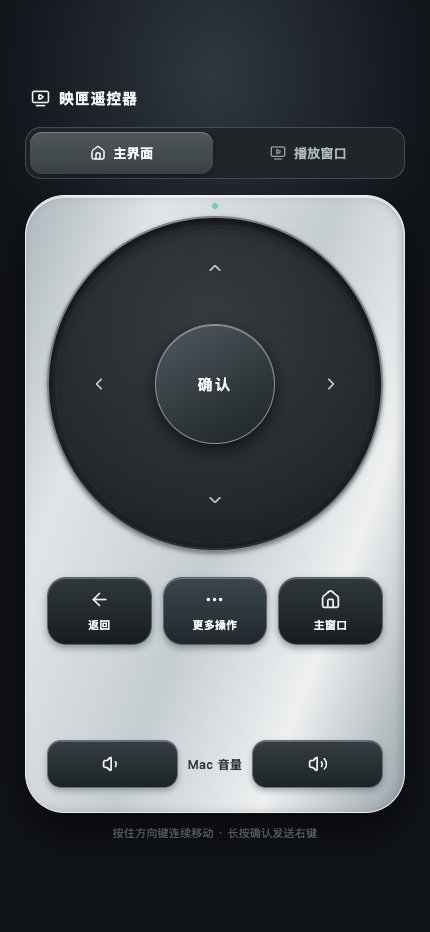

# Yingxia Remote（映匣遥控器）

用同一 Wi-Fi 下的手机浏览器控制 Mac 上的[映匣](https://github.com/jo32/tvbox-silicon)。非官方项目，需要 macOS 13+。

<p align="center">
  
</p>

## 开始使用

1. 在 Mac 上安装并打开映匣主窗口。
2. 从 [Releases](https://github.com/joisun/yingxia-remote/releases) 下载 `YingxiaRemote-*-macOS-universal.zip`，解压后将 `YingxiaRemote.app` 放入“应用程序”并启动。
3. 在“系统设置 → 隐私与安全性 → 辅助功能”允许“映匣遥控器”，然后退出并重新打开应用。若出现“自动化”授权提示，也需允许。
4. 手机连接同一 Wi-Fi，扫描连接窗口的二维码，或用浏览器打开窗口显示的地址。

预览版未经 Apple 公证。若首次打开被阻止，先尝试打开，再到“系统设置 → 隐私与安全性”点“仍要打开”。

服务使用 `8765` 端口且无需登录，**同一网络中能访问该端口的设备都可以遥控**。仅在可信网络中使用，用完从菜单栏退出。

连接失败时，检查 Mac 防火墙和路由器的客户端隔离设置。Mac 的 Wi-Fi 地址变化后，重新打开应用获取新地址。

## 遥控操作

- 主界面：方向键选择内容，确认打开，返回上一级。长按确认或点“更多操作”发送右键。
- 播放窗口：确认键切换播放与暂停，左右跳转，上下调播放器音量，支持全屏和静音。
- Mac 音量：调节系统输出音量。按住方向键或音量键可连续操作。

顶部标签只切换已有窗口。主界面导航依赖映匣的辅助功能控件，部分页面和版本可能需要适配。

## 本地构建

安装 Xcode Command Line Tools 后运行：

```sh
./build-app.sh
open dist/YingxiaRemote.app
```

生成 Apple Silicon 和 Intel 通用版，默认使用临时签名。`server.py` 是旧版开发入口，Release 使用原生 `.app`。

## 发布与许可

推送 `v0.1.0-preview.1` 这样的标签发布预览版。正式版标签如 `v0.1.0`，需要 Developer ID 签名及 Apple 公证，所需 secrets 见[发布工作流](.github/workflows/release.yml)。

源码使用 [MIT License](LICENSE)，内置 Lucide 图标遵循其[许可证](icons/LUCIDE-LICENSE)。
